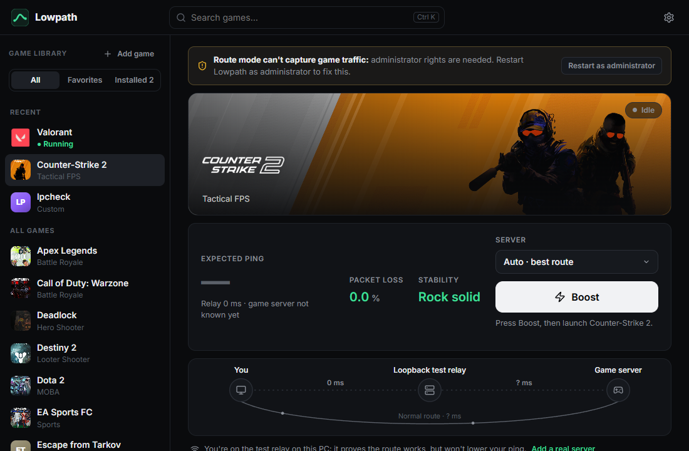
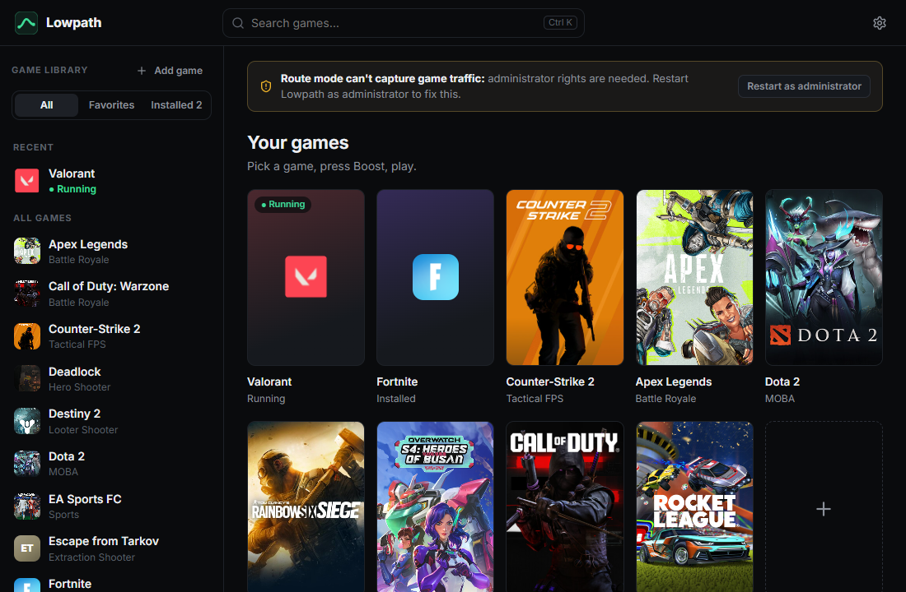
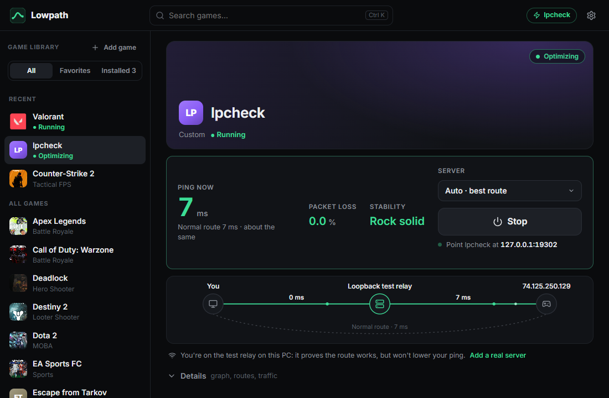
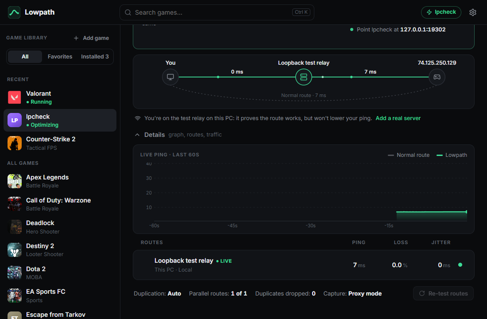
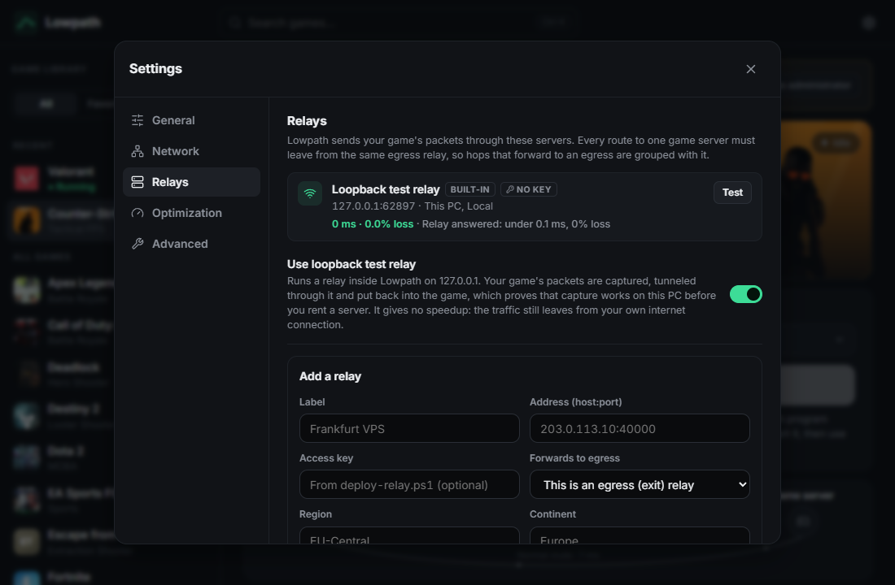
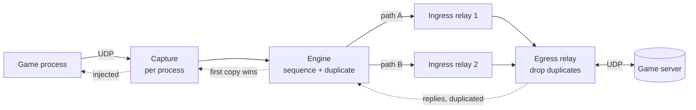

<div align="center">


# Lowpath

**Free, open-source game network optimizer.**
Pick a game, press **Boost**, play — with lower, steadier ping and less packet loss.

[](LICENSE)
[](#platform-support)
[](deploy/README.md)
[](go.mod)
[](CONTRIBUTING.md)



</div>

---

## Why Lowpath

Your ISP picks the route your game packets take, and that route is often
long, congested or lossy. Lowpath sends **only your game's traffic** through
relay servers on better-peered networks, sends each packet down **several
paths at once** so a loss on one path never reaches you, and shows you
**honest before/after numbers** measured on your own connection.

- **No accounts, no subscriptions, no telemetry.** Open the app and play.
- **No game settings to change.** Traffic is captured per process,
  automatically. The rest of your PC stays on the normal connection.
- **You own the network.** Run relays on any cheap Linux VPS near your game's
  servers, with one command.

## Features

| | |
|---|---|
| **One-button boost** | Pick a game from your library and press Boost. Routes are measured automatically. |
| **Transparent capture** | Only the selected game's UDP traffic is diverted (WinDivert, signed driver); everything else is untouched. |
| **Multipath + duplication** | Each packet travels several relay paths; the first copy wins, so one bad path can't cause a spike. |
| **Smart route selection** | Paths are ranked by ping, jitter and loss; degraded routes are swapped out, dead ones replaced instantly. |
| **Kill switch** | If every route fails, block the game's traffic or fall back to the direct route — your choice. |
| **Plays fair with other tools** | ExitLag, NoPing and other boosters, leftover packet filter drivers and full-tunnel VPNs are named with what to do; Lowpath never fights another driver for your game's packets. |
| **Fails open** | If Lowpath hangs, crashes or is killed mid-match, the game goes back to your normal connection within a second, and Lowpath tells you what happened. |
| **Honest measurements** | Before = your direct ping to the real game server. After = relay path + the relay's own ping to the server. No made-up numbers. |
| **"Why am I lagging?"** | Settings → Diagnostics turns the tests below and your last boost into one verdict (your Wi-Fi, a full line, the ISP's route, the game server, or "already optimal: Lowpath isn't needed"), with a confidence level and the measurements behind it. Exports a text report with addresses cut to /24. |
| **Bufferbloat test** | Settings → Diagnostics grades how much your ping rises when the line is full (A+ to F); during a boost a banner says when a download or stream is filling your connection. |
| **Route trace (MTR)** | Settings → Diagnostics measures loss and delay at every router to a relay or server, 200 times each, and says where loss that reaches the destination starts; routers that only skip answering aren't blamed. Over ICMP, or UDP to your relay's port. Exports a text report. |
| **Live route map** | See *You → Relay → Game server* with the latency of each leg, plus a 60 s live graph. |
| **Real game art** | Covers, banners and logos from your Steam library, and icons from your installed games. |
| **Any game** | 22 popular games built in; add any other program that uses UDP in two clicks. |
| **Self-hosted relays** | Keyed relays with abuse protection, deployed to a VPS over SSH by one script. |
| **Built-in test relay** | Verify the whole pipeline on your own PC before renting a server. |

<table>
<tr>
<td></td>
<td></td>
</tr>
<tr>
<td align="center"><sub>Your library, with real game art</sub></td>
<td align="center"><sub>Boosting: live ping, loss, stability and route map</sub></td>
</tr>
<tr>
<td></td>
<td></td>
</tr>
<tr>
<td align="center"><sub>Details: 60 s graph and per-route numbers</sub></td>
<td align="center"><sub>Relays: add your own, or use the test relay</sub></td>
</tr>
</table>

## How it works



1. **Capture.** A network-layer filter takes the game's outbound UDP packets
   off the wire. Packets from other programs are passed straight back.
2. **Tunnel.** The engine numbers each packet and sends copies over the best
   relay paths using a small authenticated overlay protocol.
3. **Deduplicate.** The egress relay, close to the game server, forwards the
   first copy and drops the rest. Replies come back the same way.
4. **Inject.** The client delivers each reply into the game's socket, so the
   game never knows.

Details: [architecture](docs/architecture.md).

## Getting started

### Requirements

- Windows 10 or 11 (x64), administrator rights (the capture driver needs them)
- For a real speedup: a Linux VPS near your game's servers (any 1 vCPU plan)

### Build and run

```powershell
git clone https://github.com/omdezo/lowpath.git
cd lowpath
.\build.ps1 -SkipTests
.\dist\Lowpath.exe
```

Building needs [Go](https://go.dev/dl/) and [Node.js](https://nodejs.org/).
Lowpath asks for administrator rights once at start (UAC).

### First boost

1. Open a game and choose **Try it on this PC** to use the built-in test
   relay, or **Add my server** to use your own relay.
2. Press **Boost**, then launch the game. Lowpath picks up its traffic
   automatically.
3. Watch ping, loss and stability live. Press **Stop** (or just quit the
   game) to go back to your normal connection.

> The built-in test relay proves capture works but can't lower your ping —
> its traffic still leaves from your own connection. Real gains need a relay
> on a better-peered network near the game's datacenter.

## Run your own relay

```powershell
.\deploy\deploy-relay.ps1 -Server root@YOUR_VPS_IP
```

The script uploads the relay, installs it as a `systemd` service, opens the
UDP port and prints the **address** and **key** to paste into
**Settings → Relays**. Full guide, forwarding hops and security notes:
[deploy/README.md](deploy/README.md).

## Platform support

| Component | Windows | Linux | macOS |
|---|:---:|:---:|:---:|
| Desktop client | ✅ | 🧪 headless, route mode over TUN | 🛠️ planned |
| Relay server | builds | ✅ | builds |
| `lpcheck` route checker | ✅ | ✅ | ✅ |

On Linux, `lowpath -headless` runs the same engine and UI in a browser, and
route mode captures through a TUN device (root, or `CAP_NET_ADMIN` and
`CAP_NET_RAW`; see [docs/development.md](docs/development.md#on-linux)). The
Linux window and packages and the macOS client are on the
[roadmap](docs/roadmap.md).

## Supported games

Built-in profiles (process detection and art) for VALORANT, League of Legends,
Counter-Strike 2, Dota 2, Deadlock, Fortnite, Apex Legends, PUBG, Rainbow Six
Siege, Overwatch 2, Call of Duty, Rocket League, Marvel Rivals, EA Sports FC,
Roblox, Escape from Tarkov, Destiny 2, Lost Ark, Path of Exile 2, Street
Fighter 6, Tekken 8 and World of Warcraft — plus **any** other game you add
from the running programs.

Known limits today: UDP over IPv4 only (TCP and IPv6 go direct), and some
anti-cheats may object to the capture driver. Both are tracked on the
[roadmap](docs/roadmap.md).

## Project layout

```
cmd/lowpath        desktop app (API + embedded UI + window)
cmd/relay          relay server
cmd/lpcheck        STUN route checker
internal/          platform layer, capture, engine, relay, protocol, app and helpers
ui/                React + TypeScript interface
deploy/            relay install scripts
e2e/               end-to-end UI test
docs/              architecture, roadmap, development guide
scripts/           local CI pipeline
```

## Development

```powershell
.\scripts\ci.ps1      # the full pipeline locally: vet, tests, UI, builds
```

Everything about building, testing (unit, internet and end-to-end tests) and
the codebase is in the [development guide](docs/development.md).

## Roadmap

The [roadmap](docs/roadmap.md) lists every known gap with acceptance tests
and milestones: network diagnostics ("is it my Wi-Fi?"), live server lists
for every game, anti-cheat-safe capture, TCP routing, forward error
correction, a community relay directory, Linux and macOS clients, an
installer and auto-update.

## Contributing

Contributions are welcome — code, game data, relay reports and docs. Read
[CONTRIBUTING.md](CONTRIBUTING.md) to get started, and report security issues
privately as described in [SECURITY.md](SECURITY.md).

## License

Lowpath is released under the [MIT License](LICENSE).

The bundled WinDivert driver and DLL (`internal/divert/bin/`) are third-party
software under their own license (LGPL v3 or GPL v2); see
[WinDivert-LICENSE.txt](internal/divert/bin/WinDivert-LICENSE.txt).

Game names, logos and artwork are trademarks of their respective owners.
Lowpath is not affiliated with any game publisher. Artwork is loaded at
runtime from your own Steam client cache or Steam's public CDN and is not
distributed with this project.
